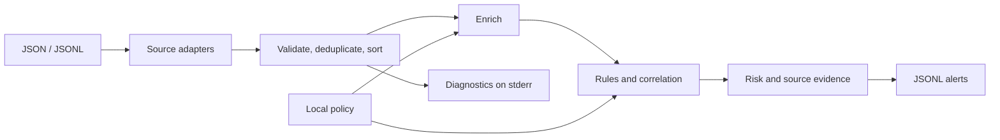

# Security Event Pipeline

A local Python tool for processing security-log exports into explainable alerts. It normalizes authentication, endpoint, cloud, and SaaS records, adds identity and asset context, evaluates configured rules, and correlates related events within a batch.

Python 3.12+. Processing requires no services, credentials, or network access.



## Quickstart

Install [uv](https://docs.astral.sh/uv/getting-started/installation/), then run from this directory:

```sh
uv sync --locked
uv run security-event-pipeline samples/events.jsonl --config samples/config.json
uv run security-event-pipeline samples/events.jsonl --config samples/config.json --output alerts.jsonl
```

The compact sample contains nine events and produces five alerts, including repeated failed logins followed by success and a suspicious process followed by an external connection. Inspect the [complete expected output](samples/expected-alerts.jsonl).

For the mixed-source example:

```sh
uv run security-event-pipeline samples/mixed-events.jsonl --config samples/mixed-config.json
uv run security-event-pipeline samples/vendors/okta.jsonl --config samples/mixed-config.json
```

The mixed corpus contains 266 synthetic events and produces [12 alerts](samples/mixed-expected-alerts.jsonl). It combines routine activity with cloud policy changes, an MFA reset, repository changes, and correlation scenarios. The records demonstrate documented adapter subsets; they are not captured customer logs or a detection-accuracy benchmark.

## Source coverage

| Source | Supported input |
| --- | --- |
| Generic exports | Authentication, endpoint, and cloud records |
| AWS CloudTrail | Selected API and console-login records |
| GCP Audit Logs | Cloud Logging entries containing AuditLog payloads |
| Okta System Log | Session, MFA, and audit events with actor and client IP |
| GitHub organization audit | Repository and organization activity |
| Linux osquery | Process and socket event results |
| macOS osquery | EndpointSecurity process event results |

Vendor records use a collector envelope: `source`, `tenant`, and the native `record`. Generic and vendor records can share a file. Collection, API pagination, and unpacking vendor response bundles happen outside this tool. See [source formats and scenarios](docs/sources.md) for mappings, official references, and limitations.

## Input and output example

A generic cloud event:

```json
{"id":"cloud-1","timestamp":"2026-01-15T10:03:00Z","type":"cloud","action":"StopLogging","outcome":"success","actor":"admin@example.test","resource":"audit-trail","src_ip":"203.0.113.10"}
```

With the sample policy, selected alert fields are:

```json
{
  "title": "Cloud audit logging disabled",
  "severity": "critical",
  "risk_score": 100,
  "contributing_events": ["cloud-1"],
  "reason": "Matched configured rule audit-disabled: cloud/StopLogging. Risk: base 80, privileged +15, sensitive +10 (capped at 100)."
}
```

Full alerts also contain an ID, detection ID, timestamp, and ordered evidence. Evidence retains normalized actions alongside original actions, types, outcomes, native IDs, and source-record fingerprints. For example, an Okta event retains `user.session.start` while detection uses `login`. Original files remain necessary for complete evidence and byte-level verification.

## Operation

```sh
uv run security-event-pipeline events.json --config samples/config.json
uv run security-event-pipeline events.log --format jsonl --config samples/config.json
uv run security-event-pipeline --help
```

- Alerts go to stdout or an atomically replaced output file; JSON diagnostics go to stderr.
- Invalid JSONL records are rejected individually. JSON arrays must parse completely.
- Exit statuses: `0` complete, `1` fatal failure, `2` partial processing or invalid CLI arguments.
- Input limits: 10 MiB and 50,000 records per batch.

See [input contracts, detection policy, and failure handling](docs/usage.md).

## Design decisions and limits

- **One common schema:** Pydantic validates data at the boundary; adapters isolate vendor details.
- **Local policy:** exact identity/asset matches and configured internal CIDRs provide enrichment.
- **Explicit detections:** single-event predicates and two correlation patterns remain inspectable. Risk combines a base score with privileged-user and sensitive-asset modifiers.
- **Batch state:** events are sorted by event time. Correlation stays within source and tenant boundaries and resets between runs.
- **Source provenance:** immutable parsed-record snapshots stay in memory; alerts include compact provenance. Fingerprints support content comparison and do not authenticate sources.
- **Limited attribution:** executable names can flag legitimate tools, and missing process-start events can make PID reuse ambiguous. External IP classification follows the configured networks.

The project supports investigation of small exports. Operational use requires environment-specific policy tuning and evaluation. [Architecture documentation](docs/architecture.md) explains state ownership and implementation boundaries.

## Development

Run checks locally:

```sh
uv sync --locked
uv run ruff format --check .
uv run ruff check .
uv run pytest
uv run mypy
uv build
```

Tests cover normalization, provenance, detection predicates, correlation boundaries, malformed input, and real CLI file processing. Named fixtures describe vendor scenarios; integration tests check the complete sample outputs. `uv.lock` pins development dependencies.

## Future improvements

Priorities are evaluation against labeled activity, environment-specific allowlists, and stronger process identity using session or boot information. Larger exports would require a streaming design with explicit handling of late events.

## License

[MIT](LICENSE).
